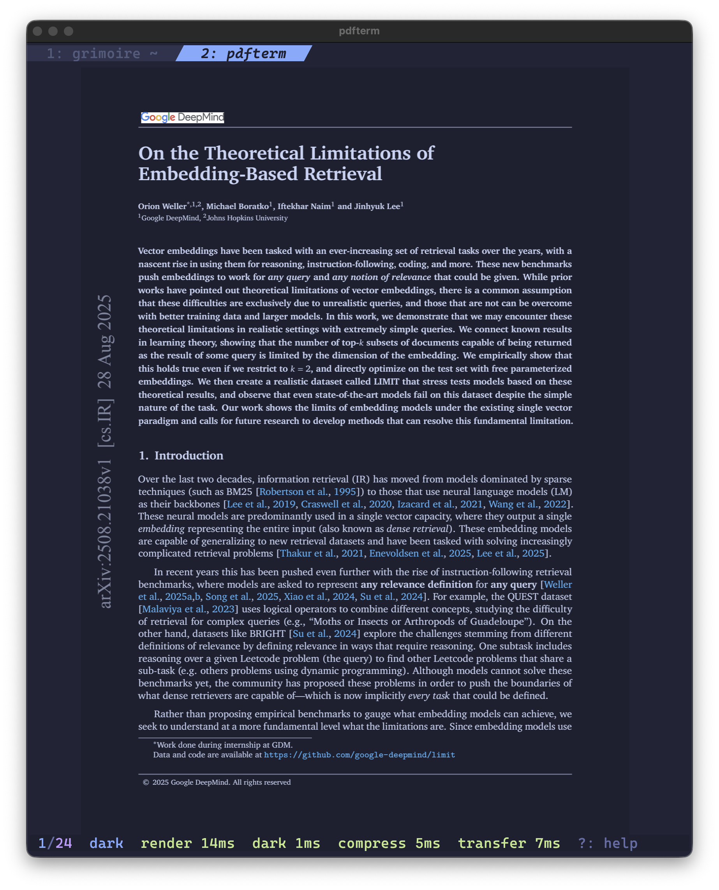

# pdfterm

`pdfterm` is a low-latency PDF viewer for Kitty, Ghostty, and WezTerm. It renders where the command runs, compresses each page once, and sends the bitmap through the Kitty graphics protocol. Direct SSH sessions need no local rendering helper.



The current page is kept when the file reloads. Omit the path, or press `f`, to open another PDF in a new tab.


## Requirements

- Rust 1.88 or newer to build
- Kitty 0.20+, Ghostty, or WezTerm with Kitty graphics support
- macOS arm64, Linux x86_64, or Linux aarch64

Run directly in the terminal; tmux graphics passthrough is not supported.

## Install

```console
cargo install --locked --git https://github.com/jrf/pdfterm.git
```

## Run

```console
pdfterm document.pdf
```

## Keys

Press `?` for the full list in the viewer.

| Key | Action |
| --- | --- |
| `j` `k` `↑` `↓` | Scroll vertically across pages |
| `h` `l` `←` `→` | Scroll horizontally, then change page |
| `Space` `PageDown` / `Backspace` `PageUp` | Page the viewport |
| `g` / `G` | First / last page |
| `:` | Go to a page |
| `/` | Search text, or filter the open list |
| `n` / `N` | Next / previous page with a match |
| `m` | Cycle fit: page, width, height, content |
| `+` / `-` | Zoom by 25% (up to 400%) |
| `0` | Reset zoom |
| `i` | Polaris-style dark mode |
| `p` | Render timings |
| `t` / `T` | Outline / theme for this session |
| `y` | Copy this page's text (OSC 52) |
| `Enter` / `L` | Link list / link list with highlights |
| `b` | Back from the last internal link |
| `f` | New tab |
| `Tab` / `Shift-Tab` | Next / previous tab |
| `Alt-1` … `Alt-9` | Jump to a tab |
| `x` / `Alt`/`Option` + click | PDF-to-source navigation |
| `q` | Leave link mode, or close the tab |
| `Esc` | Leave link mode, close a pane, clear a filter, or exit |

## Configuration

`$XDG_CONFIG_HOME/pdfterm/config.toml`, or `~/.config/pdfterm/config.toml`. First launch creates defaults; invalid configuration stops startup. See [config.default.toml](config.default.toml) for settings.

`fit_mode = "content"` fits and centers the bounds of text and graphics instead of the paper margins, using 96% of the available width and height to leave a little breathing room. Empty pages fall back to page fit with the same sizing allowance; full-page backgrounds remain part of the content. Existing page-edge placement and scrolling limits still apply. Content-fit bitmaps are limited to 16 megapixels and 32,768 pixels per side, so very sparse pages may stop enlarging before filling the viewport. Zoom and source navigation work in every fit mode.

Content fit centers on entry, including when `R` reloads a different configured fit mode into content fit. Subsequent redraws preserve panning; back/forward history and canceled navigation previews restore the saved view.

## Neovim

The bundled plugin works with [Lazy.nvim](https://github.com/folke/lazy.nvim); install the viewer separately:

```lua
{
  "jrf/pdfterm",
  main = "pdfterm",
  lazy = false,
  opts = { executable = "pdfterm", open_pdf = true, log_file = "~/.local/state/nvim/pdfterm.log" },
}
```

`:PdfTermOpen` opens a PDF. `:PdfTermForwardSplit` opens/navigates the viewer beside Neovim; `:PdfTermForward` navigates an existing viewer. `:PdfTermLog` opens the configured log file in a split. SyncTeX position checks, ambiguities, and navigation errors are recorded with timestamps and source/PDF coordinates.

Configured log-directory, open, write, and close failures report an explicit Neovim error without recursively logging it or aborting navigation.

Kitty splits require `allow_remote_control yes`; detached Neovim also needs a private `listen_on` socket. Ghostty control is macOS-only. WezTerm requires `wezterm` on `PATH`. For manual pairing, `:PdfTermViewerCommand` prints the Neovim-attached launch command and copies it to the clipboard.

For automatic local viewer splits over SSH, run `scripts/pdfterm-ssh HOST` from the client terminal. The remote needs Neovim, pdfterm, and its Neovim adapter. macOS remotes also need Python 3: their control connection uses a private, current-user-owned Unix socket relayed over SSH, without `netstat` or privileged port inspection. Linux remotes use a verified loopback reverse forward and require `ss`.

## SyncTeX (`synctex-parser`)

LaTeX navigation uses the built-in pure-Rust `synctex-parser` engine (no external `synctex` binary required on `PATH`) with a matching PDF/`.synctex(.gz)` build:

```console
latexmk -pdf -synctex=1 main.tex
```

Mouse inverse search uses standard terminal cell coordinates in Kitty and other
Kitty-graphics-compatible terminals. The query uses the center of the cell's
visible intersection with the painted page, accounting for crop and placement
offsets; it is cell-resolution input, not an exact physical pointer measurement.
There is no SGR 1016 or terminal-version requirement. More precise Ghostty
measurements are validation tools, not a production compatibility gate.

Navigation uses current saved files. The Neovim adapter does not capture compiled
source, cache source history, or reproject compiler coordinates through edits.
Save and recompile after editing before expecting accurate navigation. Inverse
delivery uses the returned file, line and byte directly; it does not relocate a
position to follow intervening edits.
Forward builds freeze the saved source line and Unicode character column before
compilation starts; later unsaved edits do not shift that request into another
saved line or word.

Native SyncTeX page and line support is authoritative. Word or image matching
adds a column when compatible with that support; no TeX execution/mutation
classifier approves the document first. Inverse refinements retain the native
source file/line or its collected frame, tabularx, caption or math body. An
incompatible or ambiguous match keeps the native anchor and never changes pages.
`precise=true` means a compatible column was accepted, not that TeX execution was
proved. Comments, definitions, nonprinting keys, notes and known discarded
arguments remain lexically masked. Macro-generated output inside a shared native
region is not independently certified.

Unique compiler graphics boxes can select `\includegraphics` or `\includesvg`
filename arguments, including text-free images. A unique scaled outer box corrects
neighboring-image hits caused by overlapping unscaled internals, but never
overrides separately selected prose. Ambiguous boxes retain native selection;
geometry/count, scope and wrapper checks remain in force.

Forward matching may refine placement only within the compiler's page and line
rectangle. No unique PDF match means that rectangle is kept. Anchor-only,
known-nonprinting, unusable-geometry and stale-source requests carry no word hint.
Root and included source inputs use the same rule.

The Neovim adapter enables saved-source Best Guess; standalone callers opt in
with `--synctex-best-guess`. This retains the explicit unchanged-since-compilation
assumption, source/revision validation and diagnostic metadata, not execution
classification. The inverse viewer status omits the routine assumption text;
mixed and other warnings remain visible.
Invalid UTF-8 or saved source over the 2 MiB refinement limit keeps native forward
geometry with a warning. Required source, access and document-revision failures
remain errors.
